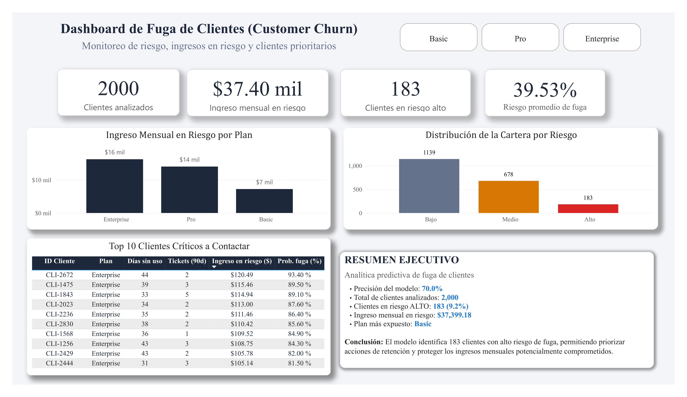

# Analítica Predictiva de Fuga de Clientes (Customer Churn BI + ML)

Pipeline analítico de extremo a extremo (*End-to-End*) que combina **Python (Machine Learning)** y **Power BI** para predecir la probabilidad de abandono de clientes SaaS, cuantificar el impacto financiero mensual y priorizar acciones de retención.


📄 [Descargar reporte del dashboard en PDF](assets/dashboard_churn.pdf)

## Problema de Negocio
En modelos de suscripción, identificar únicamente qué clientes tienen mayor probabilidad de cancelar no basta para tomar decisiones comerciales eficientes: perder un cliente *Enterprise* ($129/mes) tiene un impacto financiero casi 7 veces mayor que perder un cliente *Basic* ($19/mes).

Este proyecto resuelve la priorización comercial calculando el **Ingreso Mensual en Riesgo** (`ingreso_mensual × probabilidad_fuga`) para enfocar los esfuerzos de retención donde realmente protegen el margen.

##  Arquitectura y Flujo de Datos
1. **Generación y Preparación de Datos (`Python / pandas / numpy`):** Simulación controlada de 2,000 clientes activos con variables de comportamiento (`dias_sin_uso`, `tickets_soporte_90d`, `antiguedad_meses`) y suscripción (`plan`, `ingreso_mensual`).
2. **Modelado Predictivo (`scikit-learn`):** Entrenamiento de un clasificador **Random Forest** (`n_estimators=120`, `max_depth=7`) para estimar la probabilidad individual de fuga (0% a 100%) y segmentar la cartera en niveles de riesgo (*Bajo*, *Medio*, *Alto*).
3. **Automatización de Reporte (`resumen_ia.txt`):** Generación automática de un resumen ejecutivo con los indicadores clave de exposición.
4. **Visualización Ejecutiva (`Power BI Desktop`):** Tablero interactivo con filtros dinámicos por plan, KPIs financieros, distribución de riesgo y ranking accionable del Top 10 de clientes críticos.

##  Hallazgos del Análisis
* **Cartera analizada:** 2,000 clientes con un riesgo promedio de fuga del **39.53%** y una precisión del modelo del **70.0%** en validación.
* **Exposición crítica:** **183 clientes (9.2%)** presentan riesgo alto ($\ge 70\%$), comprometiendo **$37,399.18** en ingresos mensuales ponderados.
* **Volumen vs. Impacto Económico:** Aunque el plan **Basic** concentra la mayor cantidad de usuarios en riesgo alto, el segmento **Enterprise** representa la mayor pérdida potencial (**~$16 K/mes**) y ocupa la totalidad del Top 10 de clientes prioritarios a contactar.

##  Diccionario de Datos (`clientes_analitica_ia.csv`)

| Columna | Tipo | Descripción |
| :--- | :--- | :--- |
| `cliente_id` | Texto | Identificador único del cliente (`CLI-1000` a `CLI-2999`). |
| `plan` | Categórico | Nivel de suscripción (`Basic`: $19, `Pro`: $49, `Enterprise`: $129). |
| `ingreso_mensual` | Decimal | Facturación mensual recurrente (MRR) asociada al plan. |
| `antiguedad_meses` | Entero | Meses de permanencia del cliente en la plataforma. |
| `tickets_soporte_90d` | Entero | Cantidad de tickets de soporte abiertos en los últimos 90 días. |
| `dias_sin_uso` | Entero | Días consecutivos sin actividad registrada en la plataforma. |
| `fuga_historica` | Binario | Variable objetivo histórica (`1` = canceló, `0` = activo). |
| `probabilidad_fuga` | Decimal | Probabilidad estimada de abandono calculada por el modelo (0% – 100%). |
| `nivel_riesgo` | Categórico | Segmentación operativa: `Alto` ($\ge 70\%$), `Medio` ($40\% - 69.9\%$), `Bajo` ($< 40\%$). |
| `ingreso_en_riesgo` | Decimal | Pérdida mensual esperada (`ingreso_mensual × probabilidad_fuga / 100`). |


## Cómo reproducir el proyecto

1. Clona este repositorio:
   ```bash
   git clone https://github.com/CamilaDiaz05/bi-ia-churn.git
   cd bi-ia-churn
   ```

2. Instala las dependencias necesarias:
   ```bash
   pip install pandas numpy scikit-learn
   ```

3. Ejecuta el pipeline para regenerar el dataset y el resumen ejecutivo:
   ```bash
   python generar_y_predecir.py
   ```

4. Abre el archivo `.pbix` en **Power BI Desktop** y haz clic en **Actualizar** para cargar los datos generados.

## Tecnologías Utilizadas
* **Lenguaje y Librerías:** Python 3, Pandas, NumPy, Scikit-learn
* **Visualización de Datos:** Microsoft Power BI Desktop
* **Control de Versiones:** Git & GitHub